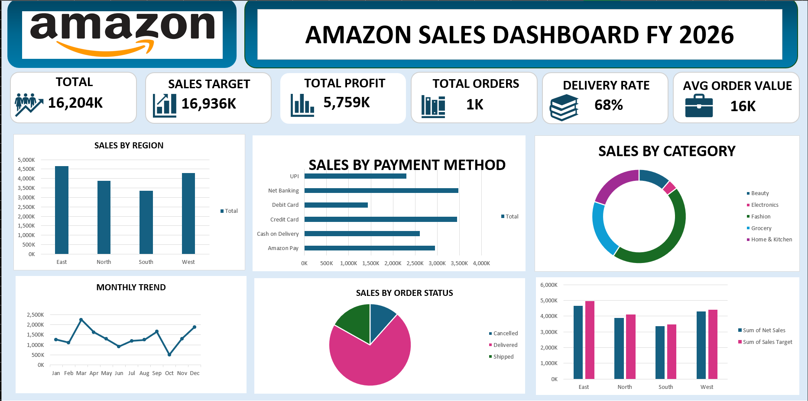

# Amazon Sales 2026 – Excel Data Analysis Dashboard

## Project Overview
This project is an Excel-based sales analysis dashboard created to explore and monitor Amazon sales performance for 2026.

The dashboard summarizes key business metrics and provides insights into sales by region, payment method, product category, monthly trends, and actual sales compared with sales targets.

## Tools & Skills Used
- Microsoft Excel
- Pivot Tables
- Data Summarization
- KPI Reporting
- Sales Performance Analysis
- Regional and Category Analysis
- Monthly Trend Analysis

## Project Objective
The objective of this project is to demonstrate practical Excel skills for e-commerce sales reporting, KPI tracking, and business performance analysis.

## Skills Demonstrated
- Organizing and summarizing sales data
- Creating Pivot Tables
- Building KPI summaries
- Comparing actual sales with targets
- Identifying regional and monthly sales patterns
- Presenting business data in a dashboard format

## Project Files
- `E-Commerce-Dataset analysis and dashboard using Excel.xlsx` – Excel workbook containing the source data, Pivot Tables and dashboard.
- `README.md` – Project documentation.
- `Dashboard.png`- Dashboard Image.
  

---

## Dataset Credits

The dataset used in this project was obtained from https://www.youtube.com/redirect?event=video_description&redir_token=QUlxb01IYTNCczhTaFJZQjVLdkN0b19oWEstZnxBQnJ0Njlrb05tcldwanNMdFZXWWFqUEs2eHRIRmhxN3lPMFFueFVmRFdkWWUxQk84UDFLWThma2R4eEh1QWQwaXVXRGNnaGM3VUtaTGEtSVlHUGlHeFY1cUhPSUxER0xwSUpZ&q=https%3A%2F%2Fdrive.google.com%2Fuc%3Fexport%3Ddownload%26id%3D1uC1p-rQhW9yX0D3i6DXq1eLx14KQFfQW&v=Vy2kDXyIyXQ.

All credit for the original dataset belongs to its respective owner.

My contribution includes data analysis, Excel Pivot Tables, KPI calculations, dashboard creation, and business insights.

This project was created for educational and portfolio purposes.
